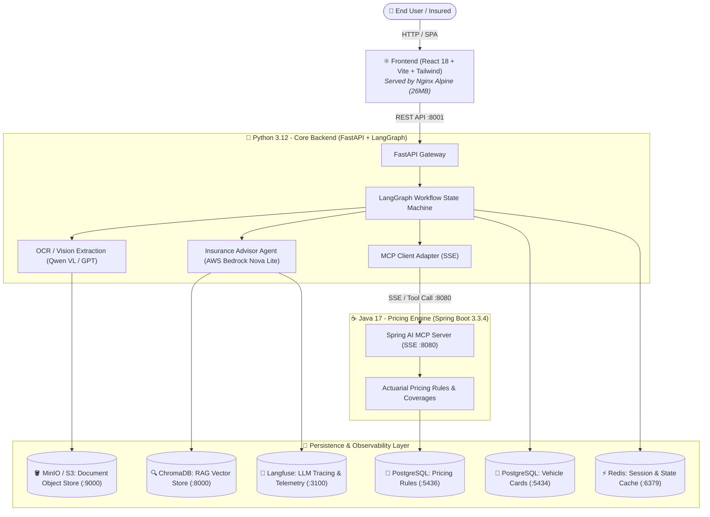
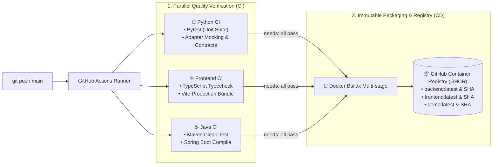

# 🚗 Insurtech AI Agent: Automated Vehicle Card Flow & Policy Negotiation

<p align="center">
  <a href="README.md">🇪🇸 Versión en Español</a> •
  <b>🇬🇧 English Version</b>
</p>

[](https://github.com/facuvgaa/arg-cedula-flow-langgraph/actions/workflows/ci.yml)
[](https://www.docker.com/)
[](https://www.python.org/)
[](https://fastapi.tiangolo.com/)
[](https://www.langchain.com/langgraph)
[](https://aws.amazon.com/bedrock/)
[](https://www.oracle.com/java/)
[](https://spring.io/projects/spring-boot)
[](https://react.dev/)

An end-to-end AI-powered auto insurance onboarding and real-time quotation platform. It combines Computer Vision with Large Language Models (LLMs) to extract vehicle ownership data from Argentine vehicle cards (*Cédula Verde / Azul*), resolves missing attributes via a robust **LangGraph** finite-state machine, negotiates policy coverages interactively with **AWS Bedrock**, and executes live actuarial pricing calculations through a **Model Context Protocol (MCP)** server built in **Java / Spring Boot**.

The entire ecosystem is architected using **Hexagonal Architecture (Ports and Adapters)**, containerized with production-grade **Docker** multi-stage images, automated via **GitHub Actions CI/CD**, and published to **GitHub Container Registry (GHCR)**.

---

## 🏛️ 1. System Architecture

A polyglot distributed microservices architecture communicating across an isolated internal Docker DNS network:



---

## 🚀 2. CI/CD & DevOps Pipeline (GitHub Actions + GHCR)

The repository features an enterprise-grade automated pipeline that validates code quality across 3 runtimes in parallel before building and publishing immutable container images upon every `push` to `main`:



### DevOps Highlights:
1. **Multi-Stage Optimization**: 
   - Frontend is built with Node 20 and copied to a lean Nginx Alpine runtime image (**26.5 MB**).
   - Backend runs under a dedicated unprivileged user (`appuser`, non-root) following CIS security benchmarks.
   - Java uses Maven for compilation and packages the `.jar` into an ultra-lightweight Eclipse Temurin JRE 17 Alpine image.
2. **Immutable Versioning**: Every build publishes both a `:latest` tag and a specific commit hash tag (`:${{ github.sha }}`) to enable instant one-command **Rollbacks** in production.
3. **Strict Secrets Decoupling**: Zero credentials or tokens are baked into images; configuration is dynamically injected at runtime via environment variables.

---

## 🛠️ 3. Tech Stack

| Component | Technologies | Purpose |
| :--- | :--- | :--- |
| **Backend** | Python 3.12, FastAPI, LangGraph, SQLAlchemy, AsyncPG | REST API, stateful workflow management, AI agents |
| **LLMs / Vision** | AWS Bedrock (Nova Lite), OpenAI Mantle, Qwen-VL | Document OCR, field extraction, interactive negotiation |
| **MCP Pricing** | Java 17, Spring Boot 3.3.4, Spring AI, HikariCP | Real-time Server-Sent Events (SSE) MCP tool server |
| **Frontend** | React 18, Vite, TypeScript, Tailwind CSS, Lucide | Responsive UI with real-time typewriter markdown streaming |
| **Databases** | PostgreSQL 15/16, ChromaDB, Redis 7 | Relational persistence, RAG embeddings, in-memory cache |
| **Object Store** | MinIO (AWS S3-compatible) | Secure storage for uploaded vehicle card imagery |
| **Observability** | Langfuse 2 | End-to-end tracing, latency, cost, and token metrics |
| **DevOps** | Docker, Docker Compose, GitHub Actions, GHCR | Container orchestration, automated CI/CD pipelines |

---

## 📦 4. Local Quickstart (Docker Compose)

Spin up the entire 10-container ecosystem with a single command:

### Prerequisites
- Docker Engine $\ge$ 24.0 and Docker Compose v2.

### Steps

1. **Clone the repository:**
   ```bash
   git clone https://github.com/facuvgaa/arg-cedula-flow-langgraph.git
   cd arg-cedula-flow-langgraph
   ```

2. **Configure environment variables:**
   ```bash
   cp .env.production.example prueba/.env
   # Add your AWS Bedrock / OpenAI credentials
   ```

3. **Build and launch all services:**
   ```bash
   docker compose up -d --build
   ```

4. **Access the application:**
   - 🌐 **Frontend (Web App)**: [http://localhost:5173](http://localhost:5173)
   - 📖 **Swagger / OpenAPI (FastAPI)**: [http://localhost:8001/docs](http://localhost:8001/docs)
   - ☕ **MCP Pricing Server (Java SSE)**: [http://localhost:8080](http://localhost:8080)
   - 🪣 **MinIO Console**: [http://localhost:9001](http://localhost:9001) *(User: `minioadmin` / Pass: `minioadmin`)*
   - 🔭 **Langfuse Dashboard**: [http://localhost:3100](http://localhost:3100)

---

## 🌐 5. Production Deployment & Cloud Auto-Scaling

For production deployments (AWS EC2 / VPS / ECS), use [`docker-compose.prod.yml`](./docker-compose.prod.yml). This configuration **does not build code on the server**: it pulls pre-built images directly from **GitHub Container Registry**.

```bash
# On the production host:
docker compose -f docker-compose.prod.yml pull
docker compose -f docker-compose.prod.yml up -d
```

### Auto-Scaling Architecture (Cloud Ready)

```
                          [ High Traffic Spike (9,000+ RPS) ]
                                          │
                                          ▼
                         [ AWS Application Load Balancer ]
                                          │
           ┌──────────────────────────────┼──────────────────────────────┐
           ▼                              ▼                              ▼
  [ ECS Task: Backend 1 ]        [ ECS Task: Backend 2 ]        [ ECS Task: Backend N ]
           │                              │                              │
           └──────────────────────────────┼──────────────────────────────┘
                                          ▼
                      [ Amazon CloudWatch Target Tracking ]
                        (CPU > 60% ➔ Triggers Auto-Scaling)
```

- **Stateless Core**: The backend preserves no state on disk. Any task can respond to any user turn.
- **Connection Pooling**: PostgreSQL connections are multiplexed via asynchronous connection poolers to prevent exhaustion under heavy concurrency.
- **Aggressive Caching**: Common policy FAQs and repeated pricing queries are cached in Redis in-memory.

---

## 🧪 6. Automated Testing

Run the automated test suites locally:

```bash
# Python Unit Tests
cd prueba
pytest tests/unit/ -v

# Live Integration Test against AWS Bedrock
pytest tests/integration/test_bedrock_live.py -s -v

# Java Spring Boot Maven Compilation & Tests
cd ../demo
mvn clean test
```

---

## 📄 License

This project is licensed under the MIT License for educational and enterprise architectural demonstration purposes.

