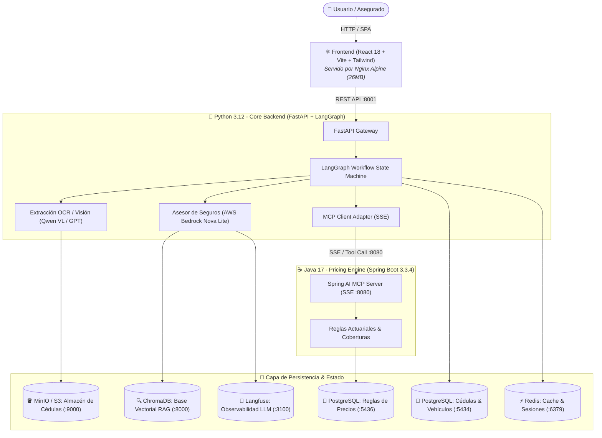
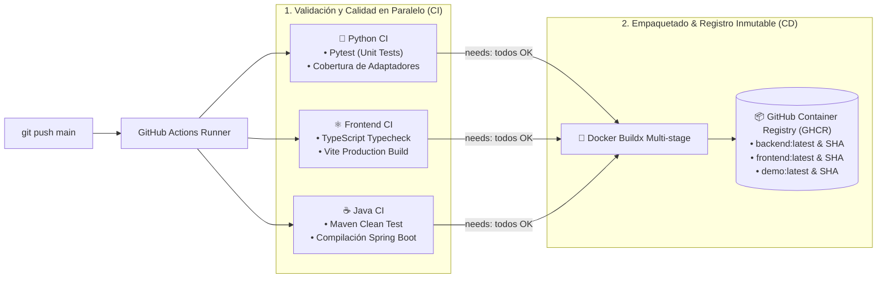

# 🚗 Insurtech AI Agent: Automated Vehicle Card Flow & Policy Negotiation

<p align="center">
  <b>🇪🇸 Versión en Español</b> •
  <a href="README.en.md">🇬🇧 English Version</a>
</p>

[](https://github.com/facuvgaa/arg-cedula-flow-langgraph/actions/workflows/ci.yml)
[](https://www.docker.com/)
[](https://www.python.org/)
[](https://fastapi.tiangolo.com/)
[](https://www.langchain.com/langgraph)
[](https://aws.amazon.com/bedrock/)
[](https://www.oracle.com/java/)
[](https://spring.io/projects/spring-boot)
[](https://react.dev/)

Sistema integral de onboarding y cotización de seguros automotores con Inteligencia Artificial. Combina visión por computadora con LLMs para extraer datos de cédulas vehiculares argentinas, valida campos faltantes mediante máquinas de estados con **LangGraph**, negocia coberturas en tiempo real con **AWS Bedrock**, y consulta cotizaciones actuariales a través de un servidor **MCP (Model Context Protocol)** implementado en **Java / Spring Boot**.

Toda la solución está diseñada bajo **Arquitectura Hexagonal**, containerizada con **Docker**, automatizada con **GitHub Actions CI/CD** y publicada en **GitHub Container Registry (GHCR)**.

---

## 🏛️ 1. Arquitectura del Sistema

El sistema implementa una arquitectura políglota distribuida en microservicios comunicados por red interna Docker:



---

## 🚀 2. Pipeline de CI/CD & DevOps (GitHub Actions + GHCR)

El repositorio cuenta con un pipeline automatizado de **Integración y Entrega Continua (CI/CD)** que garantiza calidad de código y empaqueta artefactos inmutables en cada `git push` a `main`:



### Características del Pipeline DevOps:
1. **Compilación Multi-Stage**: 
   - El Frontend se compila con Node 20 y se transfiere a un runtime limpio de Nginx Alpine, pesando solo **26.5 MB**.
   - El Backend corre con un usuario no root (`appuser`) para máxima seguridad en entornos corporativos.
   - Java se compila con Maven y se empaqueta en una imagen liviana Eclipse Temurin JRE 17.
2. **Versionado Semántico & SHA**: Cada imagen se etiqueta con `:latest` y con el hash del commit (`:${{ github.sha }}`) para permitir **Rollbacks instantáneos** en producción.
3. **Cero almacenamiento de secretos en imágenes**: Los tokens y contraseñas se inyectan en tiempo de ejecución vía variables de entorno.

---

## 🛠️ 3. Pila Tecnológica

| Componente | Tecnologías | Propósito |
| :--- | :--- | :--- |
| **Backend** | Python 3.12, FastAPI, LangGraph, SQLAlchemy, AsyncPG | API REST, orquestación de estados y agentes IA |
| **Modelos LLM** | AWS Bedrock (Nova Lite), OpenAI Mantle, Qwen-VL | Visión computacional, extracción OCR y negociación |
| **MCP Pricing** | Java 17, Spring Boot 3.3.4, Spring AI, HikariCP | Servidor MCP por Server-Sent Events (SSE) |
| **Frontend** | React 18, Vite, TypeScript, Tailwind CSS, Lucide | UI interactiva con streaming typewriter effect |
| **Bases de Datos** | PostgreSQL 15/16, ChromaDB, Redis 7 | Datos estructurados, embeddings RAG y caché |
| **Almacenamiento** | MinIO (compatible con AWS S3) | Almacenamiento seguro de imágenes de cédulas |
| **Observabilidad** | Langfuse 2 | Trazabilidad de latencia, costo y tokens de LLMs |
| **DevOps** | Docker, Docker Compose, GitHub Actions, GHCR | Containerización y pipelines automatizados |

---

## 📦 4. Despliegue Rápido Local (Docker Compose)

El stack completo de 10 contenedores se levanta con un único comando:

### Prerrequisitos
- Docker Engine $\ge$ 24.0 y Docker Compose v2.

### Pasos

1. **Clonar el repositorio:**
   ```bash
   git clone https://github.com/facuvgaa/arg-cedula-flow-langgraph.git
   cd arg-cedula-flow-langgraph
   ```

2. **Configurar variables de entorno:**
   ```bash
   cp .env.production.example prueba/.env
   # Completar con tus tokens de AWS Bedrock / OpenAI
   ```

3. **Compilar y levantar todos los servicios:**
   ```bash
   docker compose up -d --build
   ```

4. **Acceder a los servicios:**
   - 🌐 **Frontend (Web App)**: [http://localhost:5173](http://localhost:5173)
   - 📖 **Swagger / OpenAPI (FastAPI)**: [http://localhost:8001/docs](http://localhost:8001/docs)
   - ☕ **MCP Pricing Server (Java SSE)**: [http://localhost:8080](http://localhost:8080)
   - 🪣 **MinIO Console**: [http://localhost:9001](http://localhost:9001) *(User: `minioadmin` / Pass: `minioadmin`)*
   - 🔭 **Langfuse Dashboard**: [http://localhost:3100](http://localhost:3100)

---

## 🌐 5. Despliegue en Producción & Escalabilidad

Para entornos de producción reales (AWS EC2 / VPS / ECS), se provee [`docker-compose.prod.yml`](./docker-compose.prod.yml). Este archivo **no compila código en el servidor**: consume directamente las imágenes optimizadas de **GitHub Container Registry**.

```bash
# En el servidor de producción:
docker compose -f docker-compose.prod.yml pull
docker compose -f docker-compose.prod.yml up -d
```

### Arquitectura de Autoescalado (Cloud Ready)

```
                            [ Tráfico Masivo (9.000+ RPS) ]
                                          │
                                          ▼
                         [ AWS Application Load Balancer ]
                                          │
           ┌──────────────────────────────┼──────────────────────────────┐
           ▼                              ▼                              ▼
  [ ECS Task: Backend 1 ]        [ ECS Task: Backend 2 ]        [ ECS Task: Backend N ]
           │                              │                              │
           └──────────────────────────────┼──────────────────────────────┘
                                          ▼
                      [ Amazon CloudWatch Target Tracking ]
                        (CPU > 60% ➔ Dispara Auto-Scaling)
```

- **Stateless Core**: La aplicación no almacena estado local. Cualquier contenedor puede responder cualquier petición.
- **Connection Pooling**: PostgreSQL protegido mediante poolers asíncronos para evitar saturación de conexiones concurrentes.
- **Caché Inteligente**: Consultas frecuentes de pólizas cacheadas en Redis en memoria.

---

## 🧪 6. Testing Automatizado

Para correr los tests en tu entorno de desarrollo:

```bash
# Tests Unitarios de Python
cd prueba
pytest tests/unit/ -v

# Tests de Integración en vivo con AWS Bedrock
pytest tests/integration/test_bedrock_live.py -s -v

# Tests y compilación de Java Spring Boot
cd ../demo
mvn clean test
```

---

## 📄 Licencia

Este proyecto fue desarrollado con fines demostrativos y de arquitectura enterprise bajo licencia MIT.

